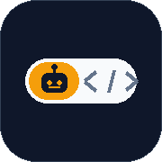
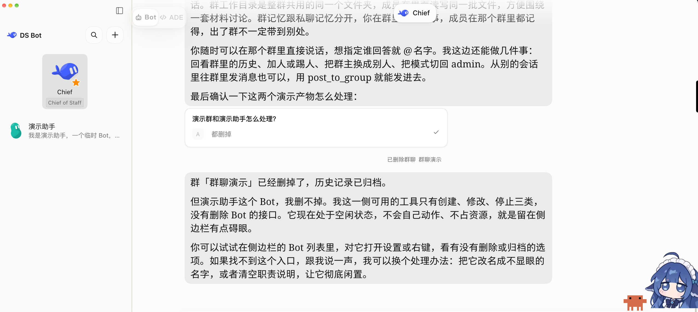
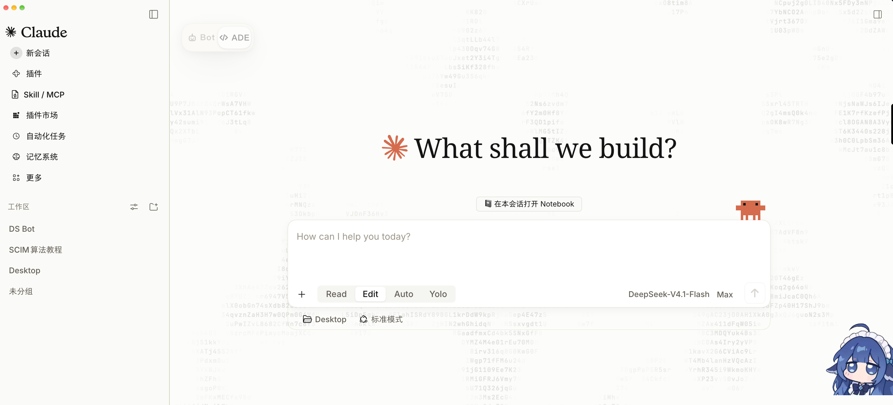

# dsh-bot-toggle


A floating **Bot / ADE** switch for the DSH web UI. It flips between the two interfaces that
[ds-bot](https://github.com/Fei2411/DS-Bot) brings — its **Bot** surface and the classic **ADE**
interface — with a single click, while **ds-bot stays loaded**.

[中文说明](README.zh.md)



## Why

ds-bot ships both interfaces but has no persistent switch: from the Bot surface you can only get
back through its account menu, and from the classic interface you need its *DS Bot* return button.
This plugin puts a small two-segment capsule on the right edge that is visible in both surfaces.

It is a UI layer on top of ds-bot, not a replacement for it: ds-bot keeps running the whole time.

## Features

- One-click switch between **Bot** and **ADE**; the active side is highlighted
- Available in both surfaces as a fixed overlay, kept clear of the content area
- Drag it anywhere, snap to an edge; right-click resets to the default position (remembered)
- Keyboard shortcut `Alt+Shift+B`
- Fades after 4 s of no interaction, restores on hover; respects `prefers-reduced-motion`
- Bilingual UI (Chinese / English) following the page or browser language
- ds-bot compatibility probe: reports whether ds-bot is loaded and, when obtainable, its version;
  if ds-bot's controls are missing, the capsule turns amber with an explanation instead of
  silently disappearing

## Screenshots

| Bot surface | Classic (ADE) surface |
| --- | --- |
|  |  |

## Requirements

- DSH Desktop `0.2.1-rc.2` / `0.2.1-rc.3` (tested)
- ds-bot installed and enabled (tested with `0.2.2`)

## Install

From DSH: **Settings → Plugins → add plugin**, then either

- the GitHub source `github:JackWoods-code/dsh-bot-toggle`, or
- the packaged `dsh-bot-toggle-<version>.tgz` from Releases (or `npm pack` it yourself)

CLI equivalent: `dsh plugin --profile desktop add github:JackWoods-code/dsh-bot-toggle`.

If the plugin page says the change takes effect at the next start, restart DSH.

## Usage

- Click **Bot** to enter the ds-bot Bot surface, **ADE** to return to the classic DSH interface.
- Drag the capsule to move it; right-click it to reset the position to the right edge, centered.
- Press `Alt+Shift+B` to toggle from anywhere.

## Debugging

Open DevTools (Settings → Account → developer tools) and check the console:

```js
__botToggle.status()
// { version, mode, painted, lang, busy, mounted, lastError,
//   dsBot: { loaded, version, compatible } }
__botToggle.probe()          // ds-bot detection result only
__botToggle.switchTo("bot")  // "classic" for the other direction
__botToggle.toggle()
__botToggle.reset()          // position reset
```

The log prefix is `[bot-toggle]`.

## Compatibility probe

ds-bot exposes no public version API — `window.dshBot` is only its theme registry hub
(`registerShape` / `registerTheme` / `themes` / `shapes`). The probe therefore reads, in order:

1. `window.__DSH_BOOT__.entries` for an entry whose `id` / `name` / `package` is `ds-bot`
   (and any `version`, `pkg.version`, `manifest.version` it may carry),
2. `window.dshBot.version` (in case ds-bot adds one),
3. `document.body.dataset.dsBotVersion` (in case it adds one).

If ds-bot appears to be loaded but neither surface's controls exist, the capsule turns amber, the
tooltip explains that the plugin may need an update, and `status().dsBot.compatible` is `false`.

## Known limitations

- **Surface switch only.** ds-bot stays loaded, so ordinary sessions still see ds-bot's tools
  (`list_bots`, `message_bot`, …). To unload ds-bot, disable it on the Plugins page instead.
- Switching relies on ds-bot's own DOM: `.bt-return`, `.bt-account`, `.bt-account-menu` and the
  localized *Switch to classic Agent mode* menu item. A ds-bot upgrade may move these; the
  compatibility probe exists to make that visible rather than silent.
- If neither interface can be detected, the capsule hides after about 1.6 s.

## Development

```sh
npm test        # DOM-stub smoke tests (node --test, no dependencies)
npm run check   # syntax check for the client bundle, host entry and tests
```

Layout: `lib/client.js` builds the web bundle, `lib/index.js` is the host entry (intentionally a
no-op), `cordis.patch.yml` inserts the `bot-toggle` plugin row.

## License

MIT © 2026 JackWoods-code. Not affiliated with DeepSeek or ds-bot.
